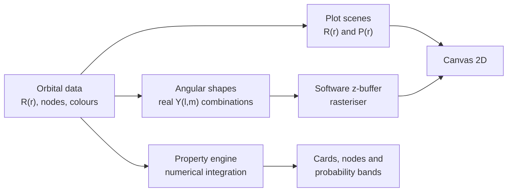
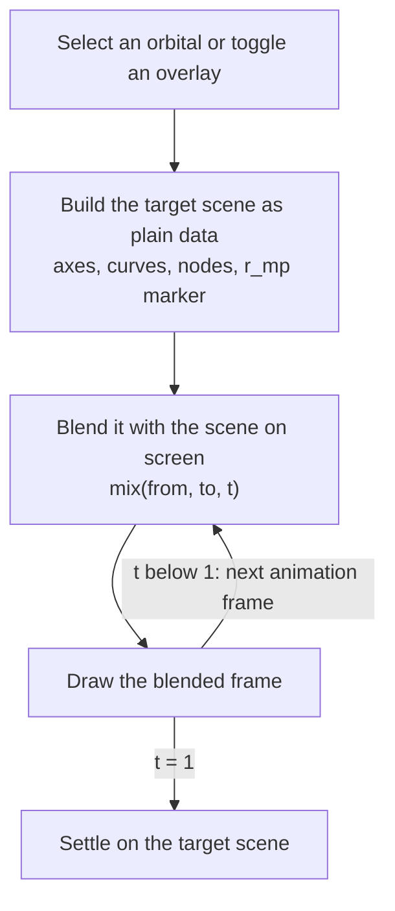
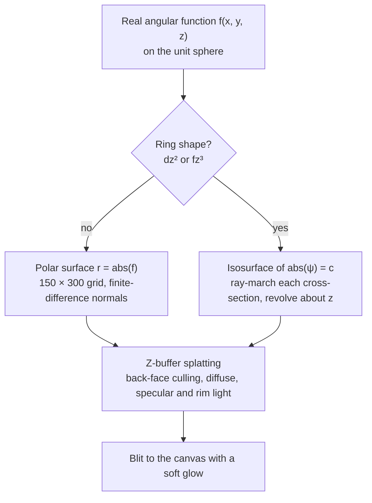

<div align="center">

<h1>Quantum Orbital Explorer</h1>

### See where the electron lives.

An interactive hydrogen-like orbital visualiser that runs entirely in your browser.<br/>
Plot radial wave functions, compare probability distributions, and spin every s, p, d and f shape in 3D.

**[Open the live demo](https://bayharborbytcher.github.io/quantum-orbital-explorer/)**&nbsp;&nbsp;·&nbsp;&nbsp;[Report a bug](https://github.com/bayharborbytcher/quantum-orbital-explorer/issues/new?labels=bug)&nbsp;&nbsp;·&nbsp;&nbsp;[Request a feature](https://github.com/bayharborbytcher/quantum-orbital-explorer/issues/new?labels=enhancement)

<br/>


[](LICENSE)


<br/>


</div>

<details>
<summary><b>More screenshots</b></summary>

<br/>

<p align="center">
  
</p>

<p align="center">
  
</p>

</details>

---

## What is Quantum Orbital Explorer?

Orbitals are usually taught from static diagrams, and a lot gets lost that way. **Radial nodes**, the sign flips in the radial wave function R(r), and the way the r² shell factor pushes the most probable radius away from the nucleus are all easier to feel than to read about.

**Quantum Orbital Explorer is a playground for exactly those ideas.** Pick an orbital and watch R(r) and the radial distribution P(r) = r²R²(r) flow into their new shapes. Red markers drop onto every radial node. A dot rides the P(r) curve to the most probable radius. Tick other orbitals to overlay them and see how their shells penetrate and decay. Then scroll down and drag any angular shape around in 3D.

Nothing here is a pre-rendered picture. Every curve, number and surface is computed in your browser from the exact hydrogenic formulas, in atomic units (a₀ = 1, Z = 1).

It is made for students meeting quantum numbers for the first time, teachers who want something livelier than a whiteboard, and anyone who enjoys seeing the maths take shape.

---

## Highlights

| | |
|---|---|
| **Real physics, not clip art** <br/> Exact hydrogenic radial functions for ten orbitals, from 1s to 4f. Every value on screen is computed from them, and the normalisation ∫ r²R² dr = 1 is checked numerically. | **Two views of one electron** <br/> R(r) and P(r) = r²R²(r) sit side by side, so you can see why the most probable radius lives away from the nucleus, even for 1s. |
| **Graphs that morph** <br/> Switching orbitals blends the old graph into the new one as a wave sweeping left to right. Axes slide, nodes fade in, and a click mid-transition simply redirects it. | **Overlay to compare** <br/> Superimpose any orbitals on R(r) and P(r) independently. Shell penetration, decay rates and node positions line up on one set of axes. |
| **It does the arithmetic** <br/> Node counts, energy, mean radius, most probable radius, angular momentum, density at the nucleus, and the share of probability between each pair of radial nodes. | **3D without WebGL** <br/> All 16 real angular shapes (1 s, 3 p, 5 d, 7 f) are drawn by a z-buffer rasteriser written from scratch, with drag, inertia and keyboard rotation. |

---

## Try it in a minute

1. Open the **[live demo](https://bayharborbytcher.github.io/quantum-orbital-explorer/)**. The 1s orbital is selected: a single smooth curve, no nodes, and a most probable radius of about 1 a₀ on the P(r) plot.
2. Click **2s** in the sidebar. Watch the curves morph and a red node appear at **r = 2 a₀**, where R(r) crosses zero.
3. Under **Overlay · ψ²(r)**, tick **2p**. The 2s and 2p distributions now share one graph, and you can compare their peaks.
4. Hover over either plot. A tooltip reads out the exact value at that radius for every orbital on screen.
5. Scroll to **Radial probability bands** to see how the electron's probability splits between the nodes.
6. Pick **3d**, then drag the **dz²** shape on the right. It has two lobes and a genuine torus around the waist. Double-click to snap back to the default view.

---

## Features

<details open>
<summary><b>Radial plots</b></summary>

<br/>

- **R(r), the radial wave function.** The radial part of ψ = R(r) · Yₗᵐ(θ, φ). Zero-crossings are marked in red with their exact radius.
- **P(r) = r²R²(r), the radial distribution.** Probability per unit radius, always non-negative, with the most probable radius r_mp marked on the curve.
- **Auto-scaling axes.** The x-range and y-range adapt to the orbital, and to every overlaid orbital, with tick spacing that adjusts to match.
- **Smooth scene interpolation.** Each graph is described as plain data and blended frame by frame, so transitions can be interrupted at any moment. Reduced-motion preferences are respected.
- **Hover readout.** Move a pointer or finger across a plot to read R(r) or r²R² at that radius, for the current orbital and every overlay.

</details>

<details>
<summary><b>Overlays</b></summary>

<br/>

- Two independent overlay lists, one for **ψ(r)** and one for **ψ²(r)**, so you can compare wave functions on one plot while keeping the other clean.
- Each orbital keeps its own colour, with the selected one drawn bold and overlays drawn thinner and fainter.
- A **Clear** button on each list shows how many overlays are active and returns to the single-orbital view.

</details>

<details>
<summary><b>Node analysis and key properties</b></summary>

<br/>

- **Quantum state cards** with n, l, mₗ and the number of degenerate orbitals.
- **Node breakdown:** radial nodes (n − l − 1), angular nodes (l) and total nodes (n − 1), with node positions and a plain-language description of each orbital's behaviour.
- **Eight property tiles:**

  | Property | What you see |
  |---|---|
  | Energy | Eₙ = −13.606 / n² eV, also in hartree, the same for every l |
  | Mean radius ⟨r⟩ | Integrated numerically, next to the analytic [3n² − l(l+1)] / 2 |
  | Most probable r | The global maximum of r²R² |
  | Angular momentum | √(l(l+1)) ħ, with the range of L_z |
  | Shell and subshell | K, L, M or N, plus sharp, principal, diffuse or fundamental |
  | Density at nucleus | 1 / (πn³) a₀⁻³ for s orbitals, zero otherwise |
  | Normalisation | ∫ r²R² dr, checked numerically |
  | Shell capacity | 2n² electrons |

- **Radial probability bands.** P(r) is integrated with the trapezoidal rule to give the exact percentage of the electron trapped between each pair of consecutive radial nodes, shown as animated bars.

</details>

<details>
<summary><b>3D angular shapes (s, p, d, f)</b></summary>

<br/>

- Every real orbital for the selected subshell is shown in its own interactive canvas: **1 s, 3 p, 5 d or 7 f**.
- **Phase colours.** Positive and negative lobes get contrasting colours derived from the orbital's own, and the x, y and z axes are drawn in the scene with the xy-plane as a reference ring.
- **Drag to rotate** with a little inertia, or focus a shape and use the **arrow keys**. **Double-click** (or double-tap) eases back to the default view along the shortest rotation.
- **Free rotate** mode on touch devices lets one finger turn a shape instead of scrolling the page.
- **True tori.** A plain polar plot flattens dz² and fz³ into a disc. Here they are drawn as isosurfaces, so the rings have real holes.

</details>

<details>
<summary><b>Orbitals included</b></summary>

<br/>

| Orbital | n | l | Radial nodes (a₀) | Orbitals in subshell |
|---|:---:|:---:|---|:---:|
| `1s` | 1 | 0 | none | 1 |
| `2s` | 2 | 0 | 2.00 | 1 |
| `2p` | 2 | 1 | none | 3 |
| `3s` | 3 | 0 | 1.90, 7.10 | 1 |
| `3p` | 3 | 1 | 6.00 | 3 |
| `3d` | 3 | 2 | none | 5 |
| `4s` | 4 | 0 | 1.87, 6.61, 15.52 | 1 |
| `4p` | 4 | 1 | 5.53, 14.47 | 3 |
| `4d` | 4 | 2 | 12.00 | 5 |
| `4f` | 4 | 3 | none | 7 |

Orbitals that share a subshell share the same R(r). They differ only in their angular part, which is what the 3D panel shows.

</details>

---

## The design

Quantum Orbital Explorer is built to feel like a calm instrument panel: dark, glowing and quick to respond.

- **One colour per orbital.** Choose an orbital and its colour follows through the plot lines, the glow, the node title, the probability bars and the 3D shapes, so you always know what you are looking at.
- **Motion with meaning.** Graphs morph rather than snap. Bars grow into place. Panels rise in softly after each selection. A reset glides back along the shortest path.
- **Direct manipulation.** Shapes follow your pointer one to one, then coast to a stop when you let go.
- **Type.** **Space Mono** for numbers and labels, **Syne** for headings.
- **Responsive.** On narrow screens the sidebar becomes a slide-in drawer, plots and panels stack, and the 3D canvases resize.
- **Sharp on any screen.** All canvases scale to the device pixel ratio, and the 3D renderer supersamples on standard-density displays.
- **Accessibility.** The 3D canvases are keyboard-focusable and labelled, overlay toggles behave as checkboxes, focus outlines are visible, and reduced-motion preferences are respected.

---

## Under the hood

The whole app is one HTML file. Its script keeps the physics, the plotting and the 3D renderer in separate sections that feed one canvas layer.



### How a transition works



Because a scene is just data, a transition is always `draw(mix(from, to, t))`. Starting a new one from wherever the old one stopped is what makes clicks interruptible. The curve is blended sample by sample with a slight delay along the x-axis, which creates the left-to-right wave.

### How the 3D shapes are drawn



A few details worth knowing:

- **Why dz² and fz³ are special.** Plotting r = |Y| for these shapes pinches the ring into a flat disc. Instead, each cross-section of the isosurface |ψ| = c is found by ray-marching in the (ρ, z) half-plane, then revolved about the z-axis with exact outward normals. The result is two lobes plus a hollow torus for dz², and two lobes plus two tori for fz³. These two shapes use a generic nodeless radial envelope, so they show the right topology rather than the true radial profile.
- **Nodes are exact.** Radial node positions are the analytic roots of each radial polynomial, for example (9 ± 3√3) / 2 for 3s, rather than values found by searching.
- **Integration range.** The normalisation, mean radius and probability bands integrate from 0 to 12n² a₀ with a step of 0.02 a₀.
- **Shared x-range.** Overlays use a common x-range chosen from the widest orbital on screen, so curves are always comparable.

### Tech stack

| Area | Choice | Why |
|---|---|---|
| Markup | **HTML5** | One page, no templating |
| Styling | **CSS3** | Grid layout, custom properties, `backdrop-filter`, and `color-mix()` for per-orbital glow |
| Language | **Vanilla JavaScript (ES6+)** | No framework, no bundler, nothing to install |
| 2D drawing | **Canvas 2D** | Full control over plots, nodes, glow and pixel density |
| 3D drawing | **Custom software rasteriser** | A z-buffer with Lambert, specular and rim shading, with no WebGL or Three.js |
| Type | **Space Mono**, **Syne** | Loaded from Google Fonts, the only external request. System fonts take over if it fails. |
| Hosting | **GitHub Pages** | A static site is all it takes |

There is no backend and no account. Everything runs in your browser.

### Where things live in `index.html`

```
quantum-orbital-explorer/
├── index.html      markup, styles and all scripts in one file
└── README.md
```

| Part of the script | What it does |
|---|---|
| `ORBITALS` | The ten orbitals: quantum numbers, R(r), radial nodes, colours and descriptions |
| `sceneOf`, `mix`, `drawScene`, `render` | Build, blend and draw the R(r) and P(r) plots |
| `renderFacts`, `updateInfo` | Property tiles, node analysis and probability bands |
| `ANG` | The real angular functions for s, p, d and f |
| `revolve`, `surfDz2`, `surfFz3`, `surf` | Surface generation for the 3D shapes |
| `raster`, `paint`, `mountShape` | The z-buffer rasteriser and the interactive 3D canvases |
| `buildCompareList`, `bindTip` | Overlay lists and the hover tooltip |

---

## Controls

| Action | How |
|---|---|
| Select an orbital | Click it in the sidebar, or open the <kbd>☰</kbd> menu on a phone |
| Overlay orbitals | Tick them under **Overlay · ψ(r)** or **Overlay · ψ²(r)**. **Clear** removes them |
| Read a value | Hover over, or touch, a plot |
| Rotate a 3D shape | Drag. Flick to let it coast |
| Rotate from the keyboard | Focus a shape and use <kbd>←</kbd> <kbd>→</kbd> <kbd>↑</kbd> <kbd>↓</kbd> |
| Reset a shape | Double-click or double-tap it |
| Free rotate | Tap **Free rotate** on a touch device so one finger turns the shape instead of scrolling |
| Close the menu | <kbd>Esc</kbd>, or tap outside the drawer |

---

## Getting started

There is nothing to install and nothing to build.

```bash
# 1. Clone
git clone https://github.com/bayharborbytcher/quantum-orbital-explorer.git
cd quantum-orbital-explorer
```

Then open `index.html` in any modern browser and you are done.

If you prefer to serve it, any static server works:

```bash
python -m http.server 8000
```

Then open **http://localhost:8000**.

### Deploying

Quantum Orbital Explorer is a static site, so any static host works. The live demo runs on GitHub Pages. In your repository, open **Settings → Pages**, choose **Deploy from a branch**, then select your main branch and the root folder.

---

## Roadmap

Ideas for where it could go next. Contributions and suggestions are welcome.

- [ ] Hydrogen-like ions: a Z slider for He⁺, Li²⁺ and beyond
- [ ] Orbitals beyond n = 4
- [ ] Complex Yₗᵐ view, with hue showing the phase
- [ ] Probability cloud and cross-section view of |ψ|²
- [ ] Choose a single mₗ and see just that 3D shape
- [ ] Export plots and 3D shapes as PNG
- [ ] Share the current view through a link
- [ ] A light theme

---

## How it was built

Quantum Orbital Explorer is a **human-directed, AI-assisted** project. The idea, the product decisions, the interaction design, the visual direction and every round of testing and feedback came from the author. The code was pair-programmed with **[Claude](https://www.anthropic.com/claude)**, Anthropic's AI assistant, which proposed architecture, wrote and refined the implementation, and helped check the physics against known results.

The result is a deliberate collaboration: a person with a clear picture of how the physics should feel, and an assistant fast enough to chase every detail of it.

---

## Contributing

Issues and pull requests are welcome. If you plan a larger change, please open an issue first so we can talk it through. Because there is no build step, testing means opening `index.html` and trying it. If you add an orbital, give it analytic radial nodes and confirm that its **Normalisation** tile reads `1.0000`.

## License

Released under the **MIT License**. See [`LICENSE`](LICENSE).

## Credits

- Typefaces **[Space Mono](https://fonts.google.com/specimen/Space+Mono)** and **[Syne](https://fonts.google.com/specimen/Syne)**, served by Google Fonts.
- The radial and angular functions follow the standard textbook forms for the hydrogen atom, in atomic units.

<div align="center">

<br/>

Made by [**bayharborbytcher**](https://github.com/bayharborbytcher)

If Quantum Orbital Explorer helped you picture an orbital, a star on the repo means a lot.

</div>
